<div align="center">



<br>

[](https://my-portfolio-inky-nine-26.vercel.app/)
[](https://viperxploit.blogspot.com)
[](https://medium.com/@arigusnawawa11)
[](https://instagram.com/inclaucode_)


</div>



## 

Halo! Saya **Muhammad Bazwa Arigusna**, mahasiswa S1 Informatika di **UPN “Veteran” Jawa Timur**. Saya suka memadukan **desain antarmuka yang estetik (UI/UX, Glassmorphism)** dengan **kecerdasan buatan (Machine Learning & Computer Vision)** dan ekosistem **Web3 (Solana)**.

| | |
|---|---|
| 🎓 **Education** | S1 Informatika, UPN “Veteran” Jawa Timur |
| 📍 **Base** | Surabaya / Tulungagung, Jawa Timur, Indonesia |
| 🎨 **Gaya kerja** | *Clean code*, antarmuka interaktif yang manis dipandang, solusi berbasis data |
| ✍️ **Blogging** | Sejak 2020 di [ViperXploit](https://viperxploit.blogspot.com): Python, HTML, dan dunia IT |
| 🟢 **Status** | Open to collaborate |


## 




## 




## 

| Repo | Deskripsi | Bahasa |
|---|---|---|
| [prediksi_penyakitjantung](https://github.com/bazwaariii/prediksi_penyakitjantung) | Prediksi indikasi penyakit jantung dengan machine learning (LightGBM) | Jupyter Notebook |
| [Smart-Home-Environmental-Condition-and-Security-Monitoring](https://github.com/bazwaariii/Smart-Home-Environmental-Condition-and-Security-Monitoring) | Sistem IoT untuk memantau kualitas udara, suhu, kelembaban, cahaya, dan gerakan secara real-time | C++ |
| [Sistem-ATM-Digital](https://github.com/bazwaariii/Sistem-ATM-Digital) | Simulasi sistem ATM digital | Python |
| [Aplikasi-Website-menggunakan-PDO](https://github.com/bazwaariii/Aplikasi-Website-menggunakan-PDO) | Aplikasi website keuangan dengan PHP PDO | PHP |


<div align="center">

</div>


## 

Punya ide, proyek, atau sekadar ingin ngobrol soal AI, UI, dan Web3? Mampir saja:

[](https://my-portfolio-inky-nine-26.vercel.app/)
[](https://viperxploit.blogspot.com)
[](https://medium.com/@arigusnawawa11)
[](https://instagram.com/inclaucode_)

<details>
<summary><b>🎮 Cheat code: ↑ ↑ ↓ ↓ ← → ← → B A</b> (klik untuk mencoba)</summary>

<br>

```
  /\_/\
 ( o.o )   Easter egg ditemukan!
  > ^ <    +1 XP, +1 kopi, +1 teman baru.
```

Terima kasih sudah menjelajah sampai sini. Kalau ada ide kolaborasi, hubungi lewat Portfolio atau Medium di atas.

</details>


